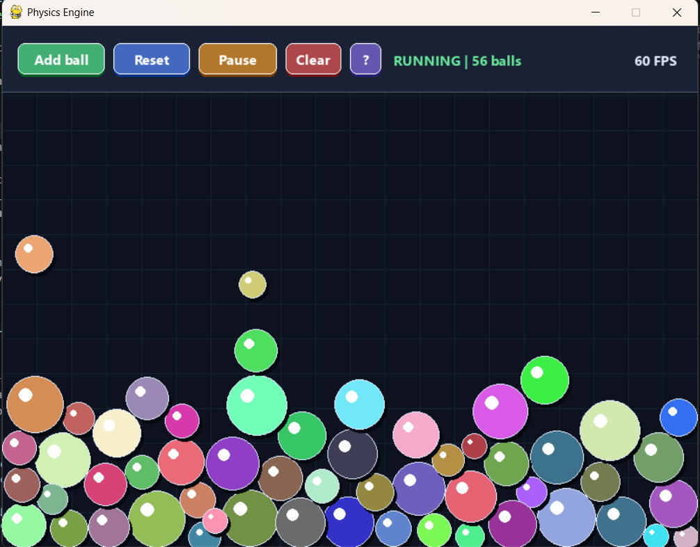

# 2D Physics Engine
>(complete)

An interactive 2D ball-physics sandbox built with Python and Pygame. Add balls,
drag them, and throw them into a simulation with gravity, damping, wall bounce,
and mass-aware circle collisions.



## Run it

```powershell
python -m venv .venv
.\.venv\Scripts\Activate.ps1
pip install -e ".[dev]"
physics-engine
```
or
```powershell
python PhysicsEngine.py
```

## Controls

| Action | Input |
| --- | --- |
| Add a ball | Click **Add Ball** |
| Grab a ball | Left-click and hold a ball |
| Throw a ball | Drag it and release |
| Pause/resume | Click **Pause** or press `Space` |
| Reset the scene | Click **Reset** or press `R` |
| Remove all balls | Click **Clear** or press `C` |
| View controls | Click the **?** toolbar button |
| Exit | Close the window |

## Project layout

| Path | Responsibility |
| --- | --- |
| `src/physics_engine/entities.py` | Ball model and hit testing |
| `src/physics_engine/physics.py` | Motion, walls, and collisions |
| `src/physics_engine/ui.py` | Pygame-only widgets and drawing |
| `src/physics_engine/app.py` | Application loop |
| `tests/` | Headless simulation tests |
| `docs/` | Architecture, physics, and contribution notes |

## Configuration

Tune `src/physics_engine/config.py` to adjust gravity, damping, restitution,
window size, or framerate. The engine uses elapsed time for consistent motion
instead of assuming every frame lasts equally long.

## Development

```powershell
pytest
ruff check .
```
